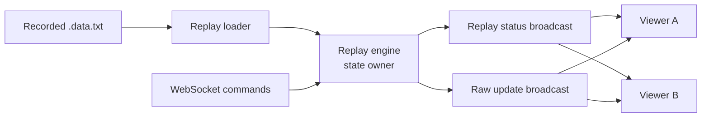

# Replay Lab — current experiment

## Purpose

Turn the existing `simulator` crate into a controllable, deterministic replay service for recorded F1 timing packets. It should support play, pause, speed changes, and seeking by update number without requiring a live F1 connection.

This is the current Rust learning experiment. It is deliberately smaller than a full desktop rewrite or forecasting system, but it touches the core skills needed for both: async tasks, Axum WebSockets, Tokio synchronization, state ownership, typed command parsing, errors, tests, and reproducible behavior.

## Starting point

The simulator currently reads every line of a saved `.data.txt` file into memory. Each WebSocket connection gets its own loop, sends one raw update every 100 ms, and closes when the file ends. It has no shared clock, no command protocol, and no seek capability.

The live `realtime` service independently merges sparse updates into a JSON state and exposes it through Server-Sent Events. The first exploration commit adds tests around that merge behavior:

- `865fd44 test: cover realtime state merging`

## Scope

### In scope

- A single shared replay clock for all simulator viewers.
- Typed WebSocket control commands: `play`, `pause`, `set_rate`, and `seek`.
- A typed status message containing the cursor, total updates, playback state, and rate.
- One producer task that advances the clock and broadcasts updates to clients.
- A client connection that receives the current replay state immediately and can send commands.
- Unit tests for command validation and playback state transitions.
- An integration-style test of multiple viewers observing the same cursor.
- Clear log messages and bounded channels so slow or disconnected clients cannot block replay.

### Not in scope

- Changing F1 data acquisition or authentication.
- Parsing every packet into a domain model.
- Saving user preferences or replay positions.
- Frontend controls, Tauri windows, ML models, Polars, or ONNX inference.
- Frame-perfect timing. The first version uses a configurable update interval and validates ordering and shared state.

## Design



### Ownership and concurrency

`ReplayEngine` owns the cursor, rate, playing flag, and ordered packet list. It receives controls through a bounded Tokio `mpsc` channel. It publishes the latest status through `watch`, because a late-joining viewer needs only the newest status. It publishes raw replay updates through `broadcast`; receivers that lag must be detected and resynchronized from the current cursor rather than causing the producer to wait.

The initial design has one state owner. WebSocket handlers do not mutate replay fields directly; they validate and submit a command. This prevents simultaneous clients from racing on a mutex-held state and makes command behavior testable without a socket.

### Message contract

Client-to-server JSON:

```json
{ "type": "play" }
{ "type": "pause" }
{ "type": "set_rate", "rate": 2.0 }
{ "type": "seek", "cursor": 1500 }
```

Server-to-client status JSON:

```json
{
  "type": "status",
  "cursor": 1500,
  "total_updates": 12840,
  "playing": true,
  "rate": 2.0
}
```

The permitted initial rates are `0.25`, `0.5`, `1`, `2`, `5`, and `10`. A seek must be an integer from `0` through `total_updates - 1`; invalid commands return a structured error and leave the engine unchanged.

### Replay behavior

- Replay begins paused at cursor `0`.
- `play` advances at one packet per base interval multiplied by the selected rate.
- `pause` retains the current cursor.
- `seek` immediately publishes status and the packet at the target cursor, then remains paused.
- Reaching the final packet pauses the engine and publishes a final status.
- A new client receives the latest status, then the packet at the current cursor before future updates.

The first implementation preserves source ordering. It does not infer real-world time from individual packet contents because recordings may be incomplete or have irregular timing.

## Implementation plan

1. Extract pure `ReplayState` and `ReplayCommand` types from the current WebSocket server module.
2. Add state transition tests before adding async execution.
3. Build `ReplayEngine` around a bounded command channel, `watch` status channel, and `broadcast` update channel.
4. Move the fixed-delay sender loop into the engine task.
5. Update WebSocket handling to multiplex incoming controls with outgoing state/update messages.
6. Add a minimal CLI configuration for base interval and bind address, retaining existing defaults.
7. Exercise two local WebSocket clients against a short fixture and confirm they remain synchronized after play, pause, rate, and seek commands.
8. Document how to run a local replay without a real feed.

## Acceptance criteria

- `cargo test -p simulator` covers valid and invalid commands, end-of-recording behavior, and seek behavior.
- Two connected clients receive the same ordered update cursor after a shared control command.
- A paused engine does not emit updates.
- An invalid rate or cursor does not modify the engine state.
- A slow client does not halt other clients or the engine.
- `cargo test --workspace` remains green.
- `cargo fmt --check` is green for files touched by this experiment. Upstream currently has one unrelated formatting difference in `api/src/endpoints/health.rs`; do not edit it as part of this work.

## Risks and decisions

| Risk | Decision for this experiment |
| --- | --- |
| Large recordings use excessive memory | Keep the existing in-memory loader for now; measure file sizes before adding indexing or streaming I/O. |
| Broadcast receivers can lag | Treat a lag as a resynchronization event, not an unrecoverable error. |
| Commands arrive at the same time | The engine serializes them through one queue; arrival order defines outcome. |
| Recording has no accurate timestamps | Base interval controls playback; true timing reconstruction is deferred. |
| Existing dashboard expects raw packets | Preserve raw update payloads and add status as a separate message type. |

## Verification record

- Rust stable 1.99.1 and Cargo are installed locally.
- `cargo test --workspace` passed before this experiment was planned.
- `cargo test -p realtime` passed with the three new state-service tests.
