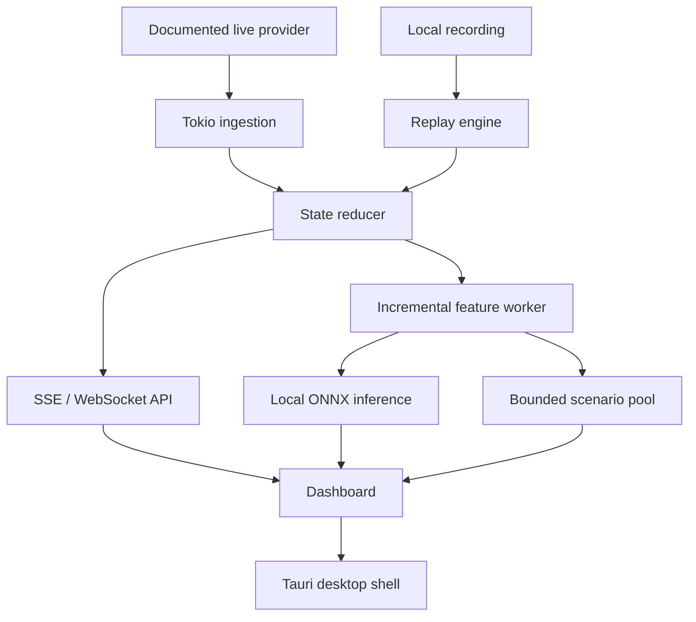

# Projected roadmap

## Direction

Use this AGPL-3.0 f1-dash fork as a private Rust learning project and an engineering portfolio. The goal is a local race-analysis workbench with dependable replay, observable live data, richer driver analysis, and eventually optional local forecasting.

The upstream project remains the foundation for live timing. New work should be isolated into small feature branches, preserve upstream license and copyright notices, and keep the fork mergeable. Do not copy proprietary Nitrous code, assets, or credentials; use independently designed features and observed behavior as inspiration only.

## Sequenced roadmap

| Stage | Outcome | Core Rust topics | Completion gate |
| --- | --- | --- | --- |
| 1. Replay Lab | Shared controllable replay for recorded packets | enums, ownership, Tokio channels, Axum WebSockets, tests | `planning.md` acceptance criteria pass |
| 2. Feed Health | Visible connection freshness and update-rate status | `Instant`, background tasks, atomics or channels, structured logs | Simulated disconnect, reconnect, and stale states are observable |
| 3. Recording Pipeline | Timestamped local capture and replay index | files, buffered I/O, serialization, bounded queues | Record then replay one complete session deterministically |
| 4. Derived Metrics | Pace, gap, position, and stint summaries | typed domain structs, iterators, error modeling, API design | Metrics agree with fixture calculations and are exposed by a versioned endpoint |
| 5. Driver Workspace | A focused driver comparison view in the dashboard | Rust API contracts plus TypeScript integration | Local replay supports a selected-driver workflow end to end |
| 6. Desktop Shell | Native app and detachable views | Tauri commands, process lifecycle, permissions, OS keychain boundaries | Main and detached windows stay synchronized through replay controls |
| 7. Forecast Baseline | Honest post-lap outcome probabilities | feature schema, model manifests, ONNX Runtime, parity tests | Python and Rust agree on saved fixtures; calibration beats a simple baseline |
| 8. Scenario Sandbox | Sensitivity analysis for pits and interruptions | Rayon, cancellation, seeds, simulation design | Reproducible scenario output and documented assumptions |

## Architecture target

One data source should own event ordering. Raw event recording, normalized state, UI snapshots, features, and predictions have distinct retention and loss requirements; avoid treating them as one queue.

## Design principles

- Build replay before relying on live sessions. It makes every later feature testable and demonstrable.
- Prefer typed domain structures at feature boundaries, but retain raw capture data for diagnosis and parser evolution.
- Use bounded queues and explicit backpressure policies. A UI can coalesce snapshots; a recorder must report drops instead of silently losing packets.
- Treat provider delay and missing fields as product state. Show freshness, source, and confidence in the UI.
- Keep credentials in Rust and native keychain storage if a validated provider integration requires them. Never emit auth tokens into browser events, recordings, or Git.
- Add Polars only after a profile identifies batch feature work that benefits from it. Incremental per-packet data should remain lightweight.
- Treat no-allocation and microsecond claims as benchmarks to earn, not properties to assume.
- Separate predictive probability from strategy advice. A model that predicts when teams pit does not prove that pitting then is optimal.

## Forecasting gates

Forecasting starts only after a reliable historical replay dataset exists.

1. Define a versioned feature schema with units, missing-value behavior, and feature ordering.
2. Train a transparent baseline against chronological, race-level held-out data.
3. Compare it with a position-only baseline using log loss, Brier score, calibration plots, and race-phase slices.
4. Export a pinned ONNX model and test Python/Rust output parity on fixtures.
5. Expose model version, source session, freshness, and uncertainty in every UI prediction.
6. Only then evaluate TCN/LSTM-style degradation models and Monte Carlo simulations.

The claimed `75.8%` predictive importance of current position is not accepted as a project assumption. Feature importance depends on dataset construction, target, timing, and evaluation method.

## Data and account boundaries

- Start with recordings and documented providers such as OpenF1 for historical/research work.
- Validate terms, data delay, rate limits, and intended use before integrating a feed.
- An F1 account login is a separate research task. Implement it only from a verified, user-authorized provider flow.
- Do not extract credentials, defeat subscription checks, or commit raw account traffic.
- Recordings may contain identifiers or URLs. Keep them ignored by Git unless scrubbed and intentionally shared.

## Repository workflow

- Work from `upstream/develop` in a focused `feature/...` branch.
- Use conventional commits and run the smallest relevant Rust test first, then the workspace suite before handoff.
- Keep local-only recordings out of Git; the upstream `.gitignore` already encourages `.data.txt` recordings to remain untracked.
- Fetch upstream before starting a substantial feature and resolve drift early.
- Preserve the AGPL-3.0 license and upstream notices in all public pushes.

## Portfolio milestones

Good public demonstrations are more valuable than claiming a broad architecture prematurely:

1. A screen recording of synchronized replay controls with an explanation of the Rust state machine.
2. A feed-health panel handling a simulated outage honestly.
3. A saved session that can be recorded, replayed, and inspected without live credentials.
4. A small model card and calibration report for any forecasting work.
5. Clear README notes separating upstream functionality from your additions.
